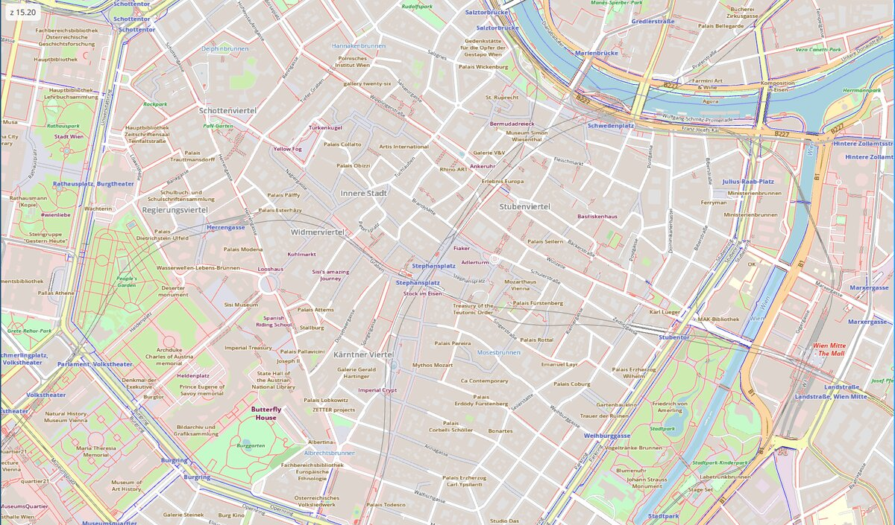

# vec-map-kit

MapLibre-styled vector tile maps as a native [GPUI](https://www.gpui.rs/)
view, for applications built with [gpui-kit](https://gpui-kit.com).


<sub>Map data © OpenStreetMap contributors, tiles and style © MapTiler.</sub>

`MapView` downloads the tiles a TileJSON document names, evaluates a
MapLibre style against them, and draws fills, lines and labels as GPUI
paths and glyphs every frame. Nothing is rasterised ahead of time, so the
map stays sharp at every fractional zoom level. Drag to pan, scroll to
zoom.

What it draws:

- `background`, `fill` and `line` layers, with data-driven colours,
  widths and opacities, and the full MapLibre expression language
  (including legacy `stops` functions).
- `symbol` layers as text: point labels and labels that follow streets
  and rivers, with halos, collision detection and fades.
- Loading tiles are covered by their parent or children, so zooming out
  doesn't flash empty areas.

## Requirements: patched GPUI

vec-map-kit only builds against GPUI with the patches in
[`patches/`](patches/README.md). One adds the rotated-glyph call that labels
along lines need; the other two make dense maps about three times cheaper
to draw. They are meant to go upstream. Until then, every application
using vec-map-kit needs the patched crates in its own `[patch]` section,
because Cargo doesn't apply a dependency's `[patch]` sections.

1. Clone this repository and run `script/vendor-gpui.sh`. It downloads
   `gpui-pre` and `gpui-pre-wgpu` 0.3.9 (the versions gpui-kit 0.8 pins)
   and applies the patches into `vendor/`.
2. In your application's `Cargo.toml`:

   ```toml
   [dependencies]
   gpui-kit = "0.8"
   vec-map-kit = { path = "../vec-map-kit" }

   [patch.crates-io]
   gpui-pre = { path = "../vec-map-kit/vendor/gpui-pre" }
   gpui-pre-wgpu = { path = "../vec-map-kit/vendor/gpui-pre-wgpu" }
   ```

If a patch is missing, the build fails with
``cannot find value `VEC_MAP_KIT_PATCH_...` ``.

Only tested on Linux (Wayland, Vulkan).

## Usage

```rust
use std::sync::Arc;

use gpui_kit::*;
use vec_map_kit::source::fetch_text;
use vec_map_kit::{MapView, Style, TileJsonSource};

fn open_map(cx: &mut App) -> Result<(), Box<dyn std::error::Error>> {
    let key = std::env::var("MAPTILER_KEY")?;
    // Both downloads block; in a real application run them off the UI thread.
    let source = Arc::new(TileJsonSource::fetch(&format!(
        "https://api.maptiler.com/tiles/v3-openmaptiles/tiles.json?key={key}"
    ))?);
    let style = Arc::new(Style::from_json_str(&fetch_text(&format!(
        "https://api.maptiler.com/maps/openstreetmap/style.json?key={key}"
    ))?)?);
    let camera = source.initial_camera();

    open_window(WindowOptions::default(), cx, |_, cx| cx.new(|_| MapView::new(source, style, camera)))?;
    Ok(())
}
```

`MapView` is an ordinary GPUI entity, so it can also be a child of any
other view. `camera()`, `set_camera()` and `set_style()` move the map or
restyle it from code.

The style's own `sources` are ignored: every layer draws from the one
TileJSON source, so the style has to be written for that source's tile
schema (OpenMapTiles for the MapTiler URLs above).

## Not supported yet

- Icons and sprites (`icon-image`), `fill-pattern`.
- `line-dasharray`, `line-gap-width` (so road casings are missing),
  `line-offset`, `fill-outline-color`, `fill-translate`, `fill-extrusion`.
- Some text properties: `text-letter-spacing`, `text-justify`,
  `text-variable-anchor`, `text-rotate`, `text-halo-blur`.
- More than one source per map, raster tiles, and PMTiles archives.
- An attribution control. Most tile providers require one; show it in
  your application.

## Development

The Nix flake provides the toolchain and GPUI's runtime libraries, and
vendors the patched GPUI on entry (`nix develop`, or `direnv allow` with
the included `.envrc`).

Run the example with a TileJSON URL and a style file or URL, optionally
followed by a zoom level and a position:

```sh
cargo run --release --example map -- \
    "https://api.maptiler.com/tiles/v3-openmaptiles/tiles.json?key=$MAPTILER_KEY" \
    "https://api.maptiler.com/maps/openstreetmap/style.json?key=$MAPTILER_KEY" \
    15 16.3725 48.2083
```

`cargo test` runs the unit tests and the MapLibre expression test suite
(`tests/maplibre_style_spec.rs`). `script/bench-vienna.sh` and
`script/bench-zoomout.sh` measure frame cost and zoom-out flicker over
central Vienna in a headless Sway session; they read `MAPTILER_KEY` from
the environment or from `.env`.

## License

MIT, see [LICENSE](LICENSE). The test fixtures in
`tests/fixtures/maplibre-style-spec/` come from
[maplibre-style-spec](https://github.com/maplibre/maplibre-style-spec)
and are under its BSD-3-Clause license
(`tests/fixtures/maplibre-style-spec/LICENSE-MapLibre.txt`).
